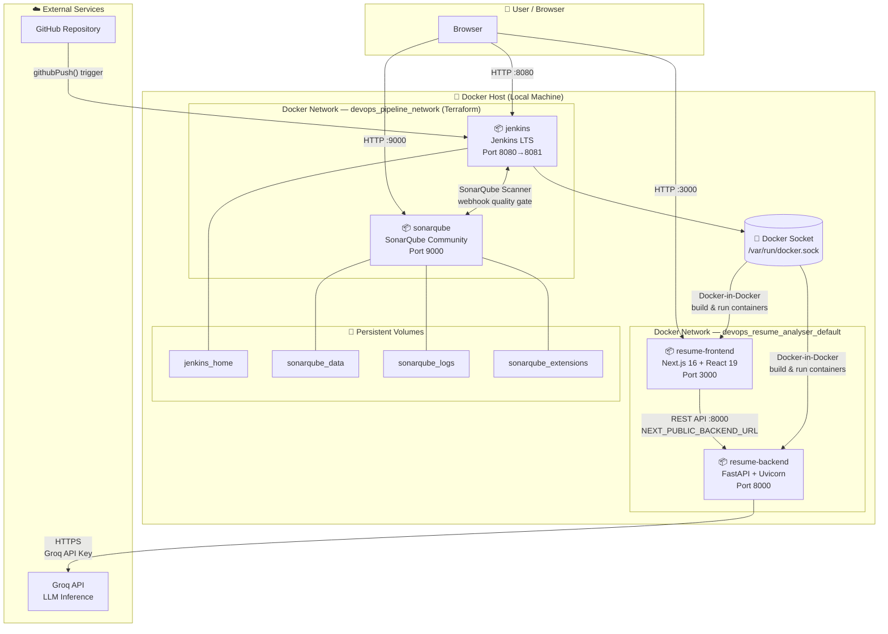
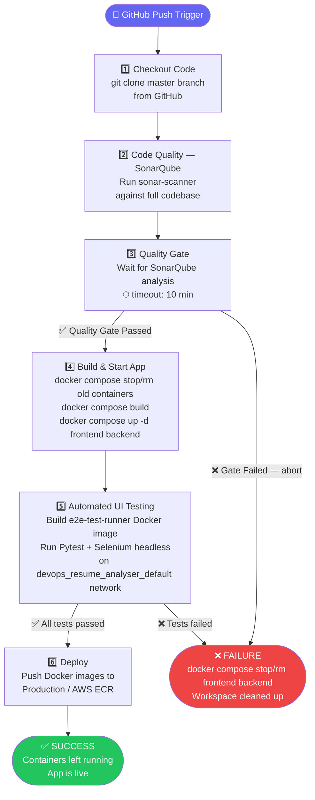

# DevOps Resume Analyzer

An AI-powered Resume Analyzer application built with a robust DevOps toolchain. This project utilizes a Next.js frontend, a FastAPI Python backend, and the Groq API to parse and analyze resumes, extracting skills, calculating ATS scores, and providing improvement suggestions.

It is designed with a strong focus on CI/CD and Infrastructure as Code (IaC), featuring an automated Jenkins pipeline, SonarQube code quality checks, and Selenium E2E testing, all orchestrated via Docker and Terraform.

## 🚀 Features

- **Frontend**: Modern, responsive UI built with Next.js 16, React 19, and Tailwind CSS v4.
- **Backend**: High-performance REST API built with FastAPI, instrumented with Prometheus metrics.
- **AI Integration**: Leverages Groq API for lightning-fast resume analysis and AI-driven insights.
- **Resume Parsing**: Extracts text from PDF resumes using ``pdfplumber``.
- **Observability Stack**: Prometheus metrics scraper & Grafana dashboards tracking API request rate, p50/p95 latency, error status codes, and host CPU/memory.
- **Infrastructure as Code (IaC)**: Terraform configurations for both local pipeline setup and full AWS Cloud deployment (VPC, Subnet, IGW, Security Groups, EC2, IAM SSM).
- **Automated CI/CD**: A comprehensive ``Jenkinsfile`` that automates checkout, SonarQube analysis, building, deploying, and E2E UI testing.
- **E2E Testing**: Automated UI tests using Pytest and Selenium (Headless Chrome) against the Next.js frontend.

## 🛠️ Technology Stack

### Application
- **Frontend**: Next.js 16, React 19, Tailwind CSS v4, TypeScript
- **Backend**: Python 3.10+, FastAPI, Uvicorn, ``pdfplumber``, ``prometheus-fastapi-instrumentator``
- **AI/LLM**: Groq API

### DevOps & Infrastructure
- **Containerization**: Docker, Docker Compose
- **CI/CD**: Jenkins
- **Code Quality**: SonarQube
- **Observability**: Prometheus, Grafana, Node Exporter
- **Cloud & IaC**: AWS (EC2, VPC, EIP, SSM), Terraform
- **Testing**: Pytest, Selenium WebDriver

## 📂 Project Structure

```text
devops-resume-analyser/
├── app/                  # Next.js Frontend App Directory
├── backend/              # FastAPI Python Backend
│   ├── app/              # Backend routes, services, utils
│   ├── Dockerfile        # Backend container definition
│   └── requirements.txt  # Python dependencies + Prometheus instrumentator
├── monitoring/           # Observability stack configuration
│   ├── prometheus/       # Prometheus scrape targets configuration
│   └── grafana/          # Provisioned datasources and dashboard JSON
├── terraform/            # Infrastructure as Code
│   ├── main.tf           # Local Docker pipeline infrastructure
│   └── aws/              # Production AWS infrastructure (VPC, EC2, IAM, EIP)
├── tests/                # Automated Tests
│   └── e2e/              # Selenium E2E tests for the frontend
├── docker-compose.yml    # Development / local CI stack
├── docker-compose.prod.yml # Production compose (Frontend, Backend, Prometheus, Grafana, Node Exporter)
├── Dockerfile            # Frontend container definition
├── Jenkinsfile           # Jenkins Pipeline automation
└── package.json          # Frontend dependencies
```

## 🏗️ Architecture Diagram

### Application & Infrastructure Architecture



### CI/CD Pipeline (Jenkinsfile)



---

## ⚙️ Getting Started

### Prerequisites

Ensure you have the following installed:
- [Docker & Docker Compose](https://www.docker.com/) (Required for running the full stack)
- [Terraform](https://www.terraform.io/) (For setting up Jenkins and SonarQube infrastructure)
- [Node.js 20+](https://nodejs.org/) (If running the frontend locally without Docker)
- [Python 3.10+](https://www.python.org/) (If running the backend locally without Docker)

### 1. Environment Variables

Create a ``.env`` file in the ``backend/`` directory using ``.env.example`` as a template:

```bash
cp backend/.env.example backend/.env
```

Ensure you configure your Groq API key:
```env
GROQ_API_KEY=your_groq_api_key_here
```

### 2. Infrastructure Setup (Optional but recommended for CI/CD)

To set up Jenkins and SonarQube using Terraform:

```bash
cd terraform
terraform init
terraform apply
```

This will create a Docker network (``devops_pipeline_network``), persistent volumes, and spin up Jenkins (Port ``8080``) and SonarQube (Port ``9000``).

### 3. Running the Application via Docker Compose

To quickly start just the application (Frontend + Backend):

```bash
docker compose up -d frontend backend
```

- **Frontend**: [http://localhost:3000](http://localhost:3000)
- **Backend API Docs (Swagger UI)**: [http://localhost:8000/docs](http://localhost:8000/docs)

### 4. Running Locally (Without Docker)

**Backend:**
```bash
cd backend
pip install -r requirements.txt
uvicorn app.main:app --reload --port 8000
```

**Frontend:**
```bash
npm install
npm run dev
```

## 🔄 CI/CD Pipeline Architecture

The pipeline is defined in the ``Jenkinsfile`` and is triggered on pushes to the repository. The stages include:

1. **Checkout Code**: Pulls the latest code from the repository.
2. **Code Quality (SonarQube)**: Runs the SonarQube Scanner against the codebase to check for code smells, bugs, and vulnerabilities.
3. **Quality Gate**: Pauses the pipeline to verify the SonarQube analysis passes the required thresholds.
4. **Build & Start App (Docker)**: Uses Docker Compose to build and start the frontend and backend containers in detached mode.
5. **Automated UI Testing (Selenium)**:
    - Spins up a temporary isolated Python Docker container on the same network.
    - Installs Google Chrome and Selenium requirements.
    - Runs Pytest scripts (``tests/e2e/test_homepage.py``) to verify frontend UI functionality in headless mode.
6. **Deploy**: A placeholder stage representing deployment to a staging or production environment (e.g., AWS ECR/ECS).

The pipeline smartly manages the lifecycle of the application containers:
- Old webapp containers are automatically stopped and destroyed before building a new version.
- If the build and tests succeed, the newly deployed webapp containers are left running so the application remains continuously available.
- If the pipeline fails, the broken containers are gracefully cleaned up.
- Core CI/CD infrastructure (Jenkins and SonarQube) is explicitly isolated and left undisturbed.

## 🧪 Testing

To run the Selenium E2E tests manually locally:

1. Ensure the frontend is running on ``http://localhost:3000``.
2. Navigate to the ``tests/e2e/`` directory.
3. Install test dependencies: ``pip install -r ../../backend/requirements.txt`` (and make sure ``pytest`` and ``selenium`` are installed).
4. Run the tests:
```bash
pytest test_homepage.py -v
```

## ❓ Common Interview Questions

> For detailed answers to all these questions, see [INTERVIEW_QA.md](./INTERVIEW_QA.md).

### 🔷 Project Overview
- What is this project and what problem does it solve?
- Walk me through the end-to-end flow of your DevOps pipeline.
- What difficulty did you face in this project and how did you solve it?

### 🐳 Docker & Containerization
- Why did you use Docker Compose instead of running containers manually?
- What is the difference between ``docker compose down`` and stopping individual services? Why does it matter here?
- How does Docker-in-Docker (DinD) work in your Jenkins setup?

### ⚙️ Jenkins & CI/CD
- What triggers your Jenkins pipeline and how?
- What happens if the pipeline fails midway? How do you handle cleanup?
- What is the difference between CI and CD? Where does each happen in your pipeline?

### 🔍 SonarQube & Code Quality
- What is a Quality Gate in SonarQube and why is it important?
- What types of issues does SonarQube detect?

### 🏗️ Terraform & IaC
- Why did you use Terraform for local Docker containers instead of just using Docker Compose?
- What is Terraform state and why is it important?

### 🤖 Selenium & Testing
- Why did you run Selenium in headless mode?
- Why did you run Selenium tests inside a Docker container instead of directly on Jenkins?

### 🧠 AI & Application
- Why did you choose Groq API over OpenAI?
- How does the resume parsing work at a high level?
- What is an ATS score and why does it matter?
- How would you scale this project to a real production environment?

### 📈 Observability & Monitoring
- How is observability implemented using Prometheus and Grafana?
- What specific metrics are captured and why are they important?

### ☁️ AWS Infrastructure as Code
- How did you provision the production infrastructure on AWS using Terraform?
- Why use AWS Systems Manager (SSM) Session Manager instead of conventional SSH key pairs?

