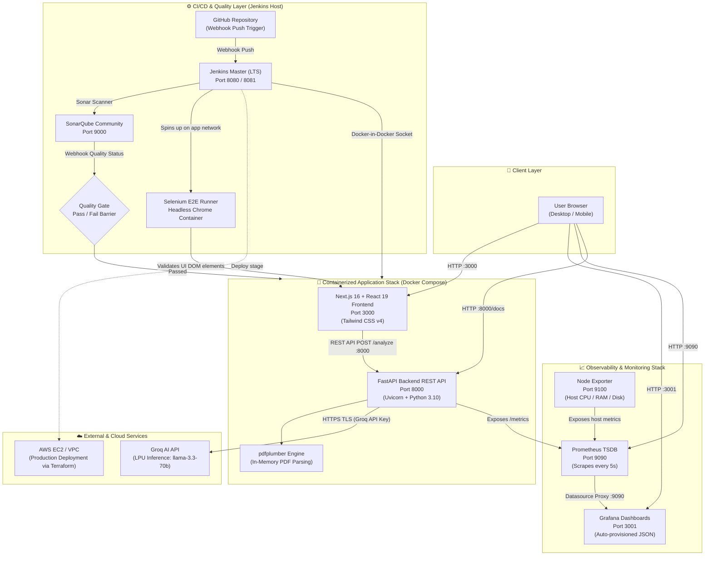
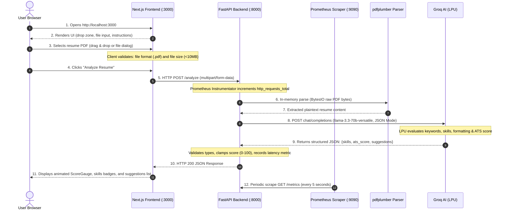
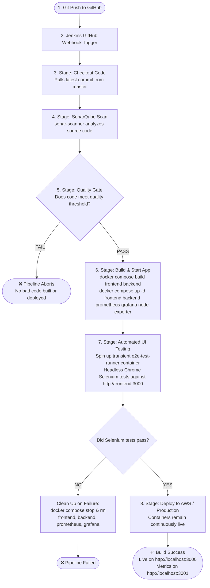
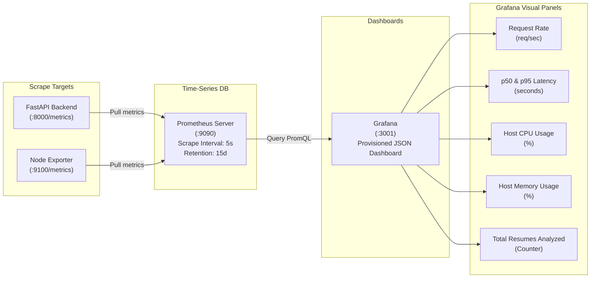
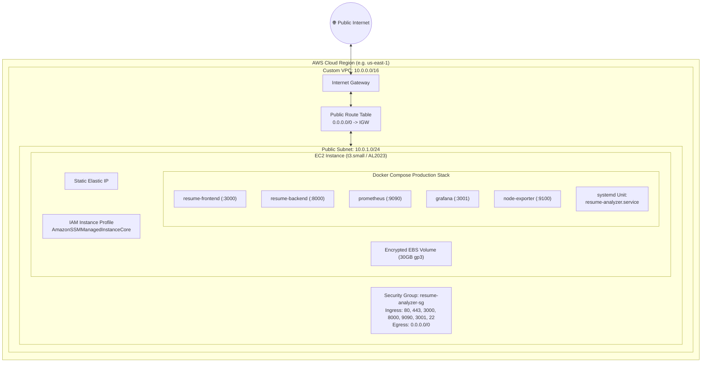

# 🏛️ Architecture & DevOps System Flow: DevOps Resume Analyzer

This document provides a comprehensive, deep-dive architectural reference and request flow guide for the **DevOps Resume Analyzer** project. Review this before running, testing, or demonstrating the project to understand what every component does and how data traverses the system.

---

## 🖼️ System Architecture Diagram

---

## 📦 Detailed DevOps Component Inventory

Here is the exact breakdown of every component in the system, its specific responsibility, port/endpoint, operational mechanism, and failure behavior:

| # | Component | Technology / Image | Port / Endpoint | Responsibility | Failure Impact & Safeguard |
|---|---|---|---|---|---|
| **1** | **Source Control** | Git / GitHub | Remote HTTPS | Tracks code changes, version control, and triggers Jenkins pipeline via webhooks (`githubPush()`). | If webhook fails, Jenkins pipeline must be triggered manually via "Build Now". |
| **2** | **CI/CD Automation Master** | `jenkins/jenkins:lts` | `:8080` (or `:8081` via TF) | Coordinates all CI/CD pipeline stages (`Checkout`, `SonarQube`, `Quality Gate`, `Docker Build`, `Selenium Test`, `Deploy`). Mounts host `/var/run/docker.sock` to orchestrate sibling containers. | If Jenkins goes down, automated deployments halt. Persistent volume `jenkins_home` preserves jobs, history, and secrets. |
| **3** | **Docker Daemon Access** | Docker Socket (`/var/run/docker.sock`) | Unix Domain Socket | Enables Docker-in-Docker (DinD). Jenkins runs Docker CLI commands that execute directly on the host daemon. | Configured to run as `root` in Terraform to prevent `permission denied` socket errors. |
| **4** | **Static Code Analyzer** | `sonarqube:community` | `:9000` | Scans Python, TypeScript, and Dockerfiles for security vulnerabilities, code smells, syntax bugs, and test duplications. | If SonarQube is unreachable, build times out after 10 minutes and aborts to prevent uninspected deployments. |
| **5** | **Quality Gate** | SonarQube Quality Gate plugin | Jenkins Step `waitForQualityGate` | Automated barrier. Evaluates scan metrics against defined thresholds (0 vulnerabilities, 0 new bugs). | If Quality Gate fails, Jenkins immediately **aborts** the pipeline before building or starting Docker containers. |
| **6** | **Container Orchestrator** | Docker Compose v2 | CLI tool | Declaratively defines and manages container lifecycles, service dependencies, bridge networks, and volumes for the multi-container stack. | Uses `docker compose stop frontend backend` instead of `down` so Jenkins and SonarQube are never killed mid-pipeline. |
| **7** | **Automated UI Test Runner** | Selenium WebDriver + Pytest | Transient container `e2e-test-runner` | Boots a temporary Python 3.10 + Headless Google Chrome container connected to `${COMPOSE_PROJECT_NAME}_default` network to verify frontend loads and file inputs exist. | If tests fail, Jenkins `post { failure { ... } }` catches it, immediately tears down the broken containers, and marks build Red. |
| **8** | **Frontend Web Application** | Next.js 16 + React 19 + Tailwind CSS | `:3000` | User-facing responsive UI. Handles drag-and-drop PDF uploads, file size/type validation, ATS score radial gauge rendering, and suggestions layout. | Uses client-side fallback handling. If backend is down, displays descriptive error card instead of crashing. |
| **9** | **Backend REST API** | FastAPI + Uvicorn (Python 3.10) | `:8000` | Receives multipart PDF upload at `/analyze`, coordinates text extraction, calls Groq LLM, handles CORS, and exposes `/health` and `/metrics`. | Includes `/health` endpoint with Docker Compose healthcheck (`test: CMD-SHELL urllib.request.urlopen`). |
| **10** | **PDF Text Extraction Engine** | `pdfplumber` (Python) | Internal Backend Library | Extracts raw text from multi-page PDF documents in-memory via `io.BytesIO` without writing temporary files to disk. | Catches empty or non-text scanned PDFs and returns HTTP 400 with actionable feedback ("The file may be scanned or image-based"). |
| **11** | **AI Inference Engine** | Groq API (`llama-3.3-70b-versatile`) | Remote HTTPS API | Evaluates resume text against ATS criteria using LPUs (Language Processing Units) with strict JSON-mode schema validation. | If API key is missing or quota exceeded, backend returns HTTP 502 with error details without crashing. |
| **12** | **Metrics Collector** | Prometheus v2.51.0 | `:9090` | Time-series database. Scrapes `/metrics` from FastAPI every 5s and Node Exporter every 5s; retains data for 15 days. | Independent scraper. If the application restarts, Prometheus retains metrics history in `prometheus_data` volume. |
| **13** | **Host Metrics Agent** | Node Exporter v1.7.0 | `:9100` | Exposes host/node hardware and OS metrics (CPU utilization, memory usage, disk I/O, network bandwidth) to Prometheus. | Read-only mounts `/proc` and `/sys`. Cannot alter host state. |
| **14** | **Observability Dashboard** | Grafana 10.4.1 | `:3001` (mapped from container `:3000`) | Visualizes metrics. Automatically provisions Prometheus data source and pre-configured `fastapi-overview.json` dashboard on startup. | Zero manual configuration required. Dashboards and data sources are fully managed as code (`provisioning/`). |
| **15** | **Local Infrastructure as Code** | Terraform (`terraform/main.tf`) | Local Docker Provider | Automates provisioning of local Docker networks and persistent volumes for the CI/CD environment. | Ensures clean, reproducible local CI/CD setup without manual volume creation. |
| **16** | **Cloud Infrastructure as Code** | Terraform AWS (`terraform/aws/`) | AWS Cloud Provider | Provisions custom VPC (`10.0.0.0/16`), public subnet, security groups, EC2 instance, Elastic IP, and IAM SSM profile. | Bootstraps entire stack on EC2 boot via `user_data.sh` with systemd service persistence. |

---

## 🔄 End-to-End Request & Data Flow (Application Level)

When an end user interacts with the application, the request flows through the following stages:

### Detailed Breakdown:
1. **User Interaction**: User visits `http://localhost:3000` (or AWS Elastic IP). Next.js serves the interactive React 19 UI.
2. **Client-side Validation**: Before any network traffic is sent, `ResumeAnalyzer.tsx` verifies that the file ends with `.pdf` and is smaller than 10MB.
3. **Multipart Upload**: The client dispatches a `FormData` POST request to `NEXT_PUBLIC_BACKEND_URL/analyze`.
4. **Metrics Tracking**: `prometheus-fastapi-instrumentator` captures incoming HTTP verb, path (`/analyze`), and begins timing the latency.
5. **Text Extraction**: `app/utils/pdf_parser.py` loads raw bytes using `pdfplumber.open(io.BytesIO(file_bytes))` and extracts all text across pages without touching physical disk.
6. **AI Analysis**: `app/services/groq_service.py` sends the text with a strictly constrained system prompt requesting:
   - `skills`: list of strings
   - `ats_score`: integer 0–100
   - `suggestions`: list of actionable strings
   Groq returns a pure JSON object in sub-second inference speed due to its LPU hardware.
7. **Response & Rendering**: Backend validates that all expected keys exist, clamps the ATS score between 0 and 100, and returns the response. The Next.js frontend transitions from the shimmering loading state to the results cards.

---

## ⚡ End-to-End CI/CD Pipeline Flow (DevOps Level)

The automated lifecycle managed by Jenkins (`Jenkinsfile`) follows this sequence:

### Stage Details:
1. **Checkout Code**: Jenkins clones or pulls the latest commit from `master`.
2. **Code Quality (SonarQube)**: Runs `sonar-scanner -Dsonar.projectKey=devops_resume_analyser -Dsonar.sources=.`. Inspects for OWASP vulnerabilities, security hotspots, syntax errors, and code smells.
3. **Quality Gate**: `waitForQualityGate abortPipeline: true` pauses Jenkins until SonarQube returns analysis status. If bugs or vulnerabilities violate standards, build aborts immediately.
4. **Build & Start Containers**:
   - Stops and removes any leftover application/monitoring containers from previous builds.
   - Preserves Jenkins and SonarQube containers intact.
   - Builds fresh Docker images for `frontend` and `backend`.
   - Starts `frontend`, `backend`, `prometheus`, `grafana`, and `node-exporter` in detached mode.
5. **Automated UI Testing (Selenium)**:
   - Jenkins creates a transient `Dockerfile.test` containing Python 3.10 and Google Chrome.
   - Connects the container to the Docker Compose network (`${COMPOSE_PROJECT_NAME}_default`).
   - Supplies `-e BASE_URL=http://frontend:3000`.
   - Runs `pytest test_homepage.py -v`.
   - Verifies the homepage loads, page title is valid, and the `#upload-zone`, `#file-input`, and `#analyze-button` exist in the DOM.
6. **Failure Recovery**: If any test fails, Jenkins executes `post { failure { ... } }`, removing broken containers and restoring server stability.

---

## 📊 Observability & Monitoring Flow

- **Instrumentation**: The FastAPI backend implements `prometheus_fastapi_instrumentator`, exposing request count, latency histograms, and HTTP response codes.
- **Scrape Targets**: Prometheus configuration (`monitoring/prometheus/prometheus.yml`) polls FastAPI and Node Exporter every 5 seconds.
- **Provisioning as Code**: Grafana mounts `monitoring/grafana/provisioning/` on launch. The datasource (`http://prometheus:9090`) and the dashboard (`fastapi-overview.json`) are injected automatically with zero manual clicks required.

---

## ☁️ Production AWS Infrastructure Topology

For production deployments, `terraform/aws/` creates the following AWS architecture:

---

## 📋 What to Expect While Testing / Running

When you test or run this project, here is your verification roadmap:

### 1. Verification Ports & URLs
| Service | URL | Credentials / Notes |
|---|---|---|
| **Frontend UI** | `http://localhost:3000` | Upload a sample PDF resume to test ATS scoring |
| **Backend API Docs** | `http://localhost:8000/docs` | Interactive Swagger UI to test `/analyze` & `/health` |
| **Backend Prometheus Metrics** | `http://localhost:8000/metrics` | Raw Prometheus text metrics format |
| **Prometheus Web UI** | `http://localhost:9090` | Check `Status -> Targets` (FastAPI and Node Exporter should be `UP`) |
| **Grafana Dashboard** | `http://localhost:3001` | **Username**: `admin` \| **Password**: `admin` Navigate to **Dashboards -> Resume Analyzer & Infra Overview** |
| **Jenkins Master** | `http://localhost:8080` | Check pipeline execution logs and stages |
| **SonarQube Server** | `http://localhost:9000` | Review code quality metrics, bugs, and Quality Gate status |

### 2. What Happens When You Run Docker Compose:
- Docker builds the Next.js frontend (using cached Alpine Node.js) and FastAPI backend (using slim Python 3.10).
- Networks and persistent storage volumes (`prometheus_data`, `grafana_data`) are initialized.
- Backend performs a health check (`/health`); once healthy, frontend accepts traffic.
- Prometheus starts scraping both FastAPI and Node Exporter every 5 seconds.
- Grafana automatically boots up pre-loaded with the Prometheus datasource and the custom dashboard.

### 3. What Happens When You Run the E2E UI Tests:
- Pytest triggers `tests/e2e/test_homepage.py`.
- Selenium launches Headless Chrome in memory.
- It validates that the frontend loads without error, page title is populated, `#upload-zone` is rendered, `#file-input` is present, and `#analyze-button` is clickable.
- Tests finish cleanly with `2 passed`.
